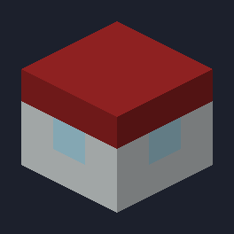
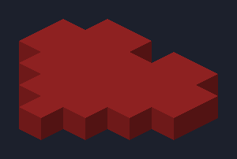
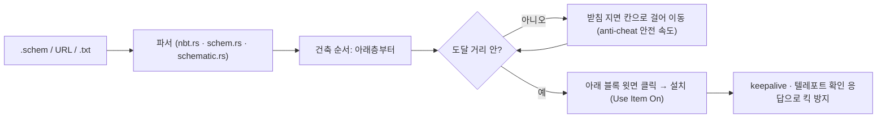

<h1 align="center">schematic-buildbot</h1>

<p align="center"><a href="README.md">English</a> · <b>한국어</b></p>

<p align="center">
  <b>Minecraft 설계도(<code>.schem</code>)를 URL 한 줄로 받아 서버에 대신 지어주는 Rust 봇</b><br>
  프로토콜(1.21.1 / 767)을 라이브러리 없이 손으로 구현 · 공중부양/과속 없이 걸어 다니며 건축 · 킥 없음
</p>

<p align="center">
  <a href="https://github.com/lilicoderr/schematic-buildbot/actions/workflows/ci.yml"></a>
  
  
  
  <a href="LICENSE"></a>
</p>

<p align="center">
  
  
</p>
<p align="center"><sub>`tools/preview.py` 로 렌더한 설계도 미리보기 (서버 없이 생성)</sub></p>

## 한눈에 보기

```bash
# 설계도 공유 사이트의 .schem 직링크를 그대로 넣으면, 받아서 지어준다 (딸깍)
build-bot 127.0.0.1:25565 MyBot https://example.com/castle.schem

# 서버 없이 검증만: 크기·블록 종류·층별 ASCII 도면·공중 블록 경고
build-bot x x castle.schem --dry-run
```

```text
=== 설계도 검증: '작은 오두막' ===
크기 3x3x3, 총 25블록

layer y=0      layer y=1      layer y=2
###            #B#            AAA
#.#            B.B            AAA
###            #B#            AAA
legend: #=white_concrete A=red_concrete B=glass
모든 블록이 설치 가능합니다. ✅
```

## 기능

| 기능 | 상태 |
|---|---|
| 프로토콜 직접 구현 (핸드셰이크·로그인·Configuration·Play, zlib 압축, 오프라인 UUID) | ✅ |
| `.schem` (Sponge v2/v3) 설계도 + 텍스트 레이어 포맷 | ✅ |
| URL 로 바로 받아 건축 (`http(s)://…/x.schem`) | ✅ |
| 블록 1333종 지원 (블록→아이템 ID 테이블) | ✅ |
| `--dry-run` 검증 + 층별 ASCII 도면 + 공중 블록 경고 | ✅ |
| 걸어 다니며 설치 (`on_ground`, 틱당 걷기 속도 이하) — anti-cheat 안전 | ✅ |
| `--delay-ms` 로 설치 속도 제한 (패킷 레이트 제한 서버용) | ✅ |
| `tools/preview.py` — 설계도 → 아이소메트릭 PNG (Python 표준 라이브러리만) | ✅ |
| 블록 상태: 계단 방향/위아래, 반블록(위/아래/통), 통나무 축, 문·침대·화로 방향 | ✅ 클릭 면·커서·시선으로 재현 (`--dry-run` 이 재현 불가 항목 보고) |
| 공중 블록 안전 순서 (이웃/위 블록을 받침으로 사용) | ✅ |
| `--resume` 이어 짓기 · `--rate` 초당 설치 상한 | ✅ |
| `--lang en\|ko` 출력 언어 | ✅ |
| `.litematic` (Litematica, 다중 리전 · 비트 패킹 팔레트) | ✅ |
| 다른 버전 서버 | 🚧 버전 표(`--version`)만 준비됨 — 검증된 ID 표는 1.21/1.21.1 뿐. 그 외는 [ViaProxy](https://github.com/ViaVersion/ViaProxy) 경유 |
| 생존 모드 + 상자에서 자재 꺼내기 | 🚧 필요한 패킷 ID 는 매핑됨 |

## 빌드 · 실행

```bash
cargo build --release

./target/release/build-bot 127.0.0.1:25566 BuildBot blueprints/cottage.txt        # 건축
./target/release/build-bot x x blueprints/cottage.txt --dry-run                     # 검증만
./target/release/packet-probe probe 127.0.0.1:25566 ProbeBot 6                     # 패킷 6초 수집·분류
python tools/preview.py blueprints/cottage.txt -o docs/cottage.png --scale 36       # 미리보기 PNG
./target/release/build-bot 127.0.0.1:25566 Bot blueprints/stair-tower.txt --resume   # 중단돼도 이어서
```

대상은 `online-mode=false`(오프라인) 서버. 로컬 테스트는 바닐라 1.21.1 을 `online-mode=false`, `gamemode=creative` 로 띄우면 된다
(봇은 크리에이티브에서 블록을 손에 들어 설치한다).

> 온라인 모드(Mojang 인증/암호화)는 범위 밖이다. 남의 서버에서는 반드시 서버 운영자의 허락을 받고 사용할 것.

## 설계도 포맷

`.schem` 외에, 손으로 그리기 쉬운 레이어/팔레트 텍스트도 지원한다 (`blueprints/` 참고).

```text
name 작은 오두막
palette W white_concrete
palette G glass
layer 0          # y=0 평면. 아래 각 줄이 z 증가, 글자가 x 증가
WWW
W.W              # '.' 또는 공백 = 공기
WWW
layer 1
WGW
```

## 동작 원리



```text
crates/mc-proto/      VarInt/VarLong, 문자열, Position, UUID, 길이 프레이밍 + zlib (의존성: flate2)
crates/mc-bot/
  net.rs  proto.rs    TCP · 핸드셰이크/상태핑/오프라인 로그인/Config
  ids.rs              1.21.1 패킷 ID (minecraft-data 대조)
  world.rs            좌표 · 시야(yaw/pitch) · 도달 거리
  nbt.rs schem.rs     NBT 리더 · Sponge .schem 파서
  schematic.rs        설계도 모델 · 건축 순서 · ASCII 도면 · 공중 블록 검출
  builder.rs          Play 클라이언트: 이동 · 설치 · keepalive
  blocks.rs           블록 → 아이템 ID (1333종)
  bin/                build-bot, packet-probe
tools/preview.py      설계도 → 아이소메트릭 PNG
```

## 왜 손으로 구현했나

- 패킷/프로토콜 수준을 직접 이해하고 검증하려고. VarInt(LEB128), Position 패킹(26/12/26), zlib 프레이밍, Configuration 전이, 오프라인 UUID(MD5)를 직접 구현하고 공식 테스트 벡터로 검증했다.
- 패킷 ID 는 [minecraft-data](https://github.com/PrismarineJS/minecraft-data) 1.21.1 정의와 대조했다.

## 이동과 anti-cheat

- 항상 `on_ground=true`, 틱당 이동량을 걷기 속도(~0.26블록) 이하로 제한 → "moved too quickly"/"flying is not enabled" 킥 없음.
- 블록은 "아래 블록의 윗면"을 눌러 설치하므로 받침 없는 공중 설치를 하지 않는다. 받침이 없는 블록은 `--dry-run` 이 미리 경고한다.
- 서버의 Synchronize Player Position(텔레포트)에는 Confirm Teleport 로 즉시 응답한다.

## 검증

- `cargo test --workspace` — 단위 테스트 (VarInt/Position/zlib/MD5 벡터, 설계도·`.schem` 파싱, ASCII 도면, 공중 블록, 도달 거리 …)
- 실서버(로컬 1.21.1): 3×3 오두막 25블록 **전부 설치**, 도달실패 0, 킥 없음 (RCON 개수로 확인).

## 기여

[CONTRIBUTING.md](CONTRIBUTING.md) · 변경 내역은 [CHANGELOG.md](CHANGELOG.md).

## 라이선스

MIT. 패킷 ID 는 PrismarineJS/minecraft-data(1.21.1)와 대조했다.
