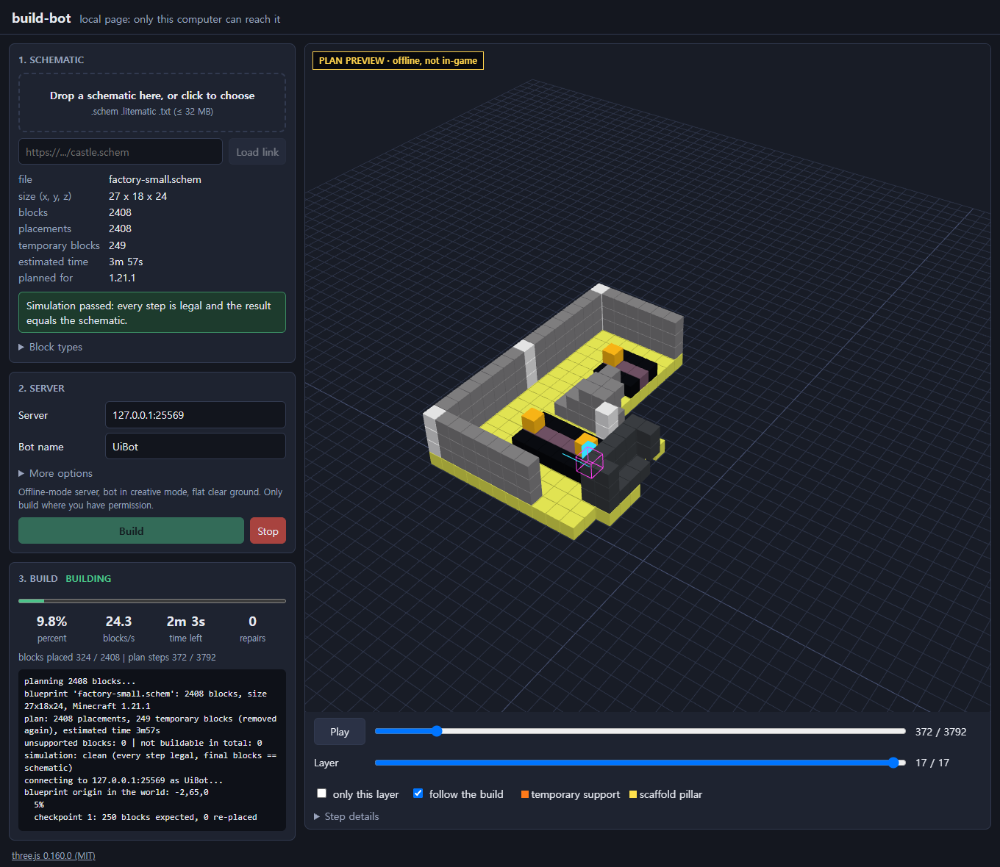
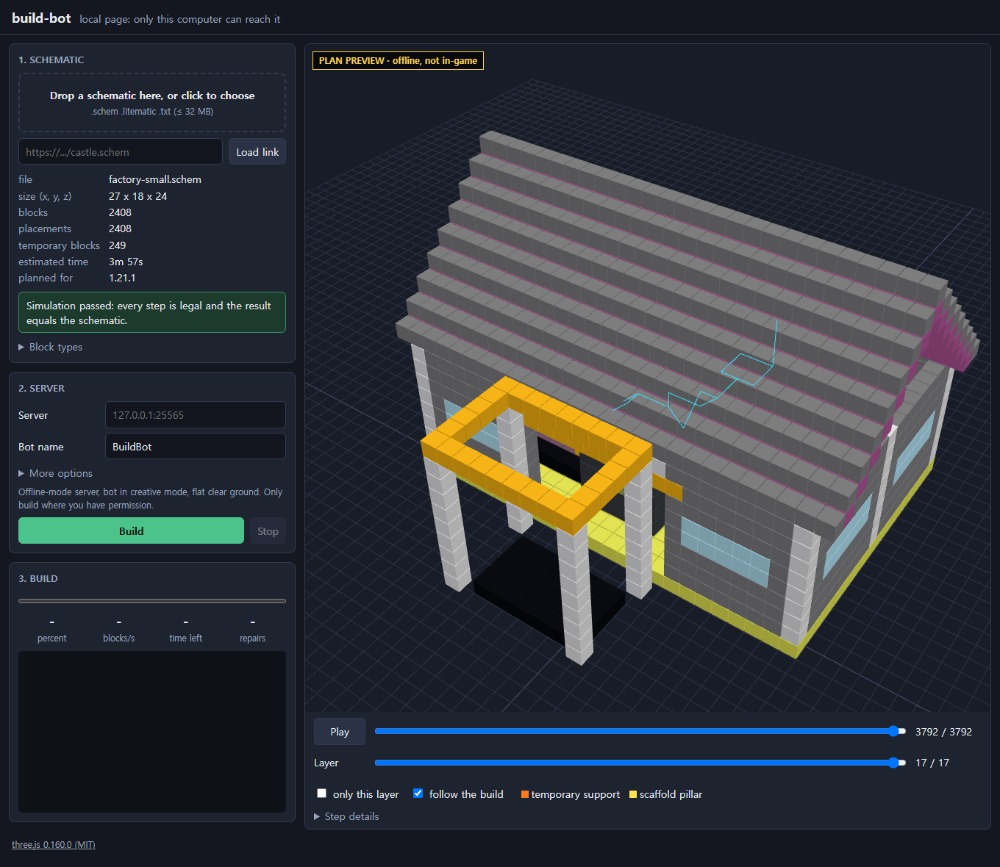
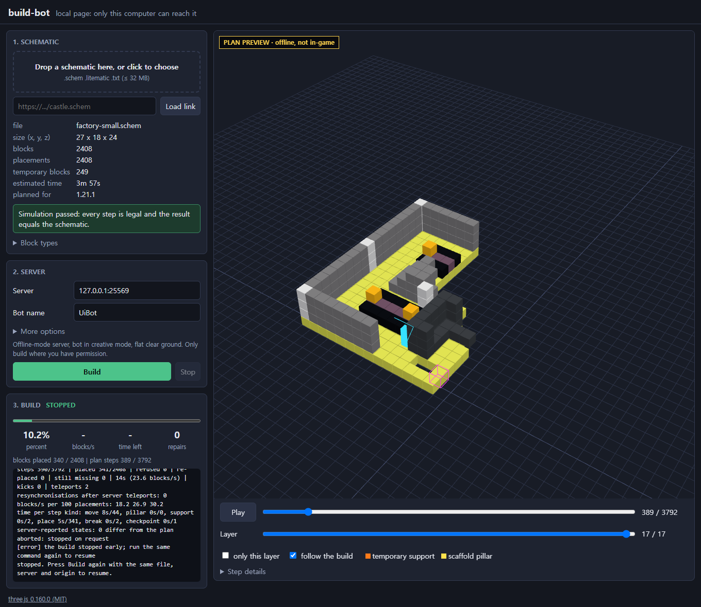
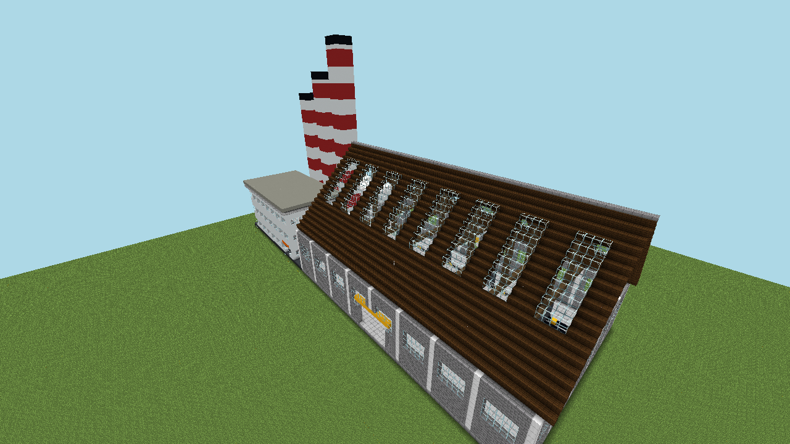
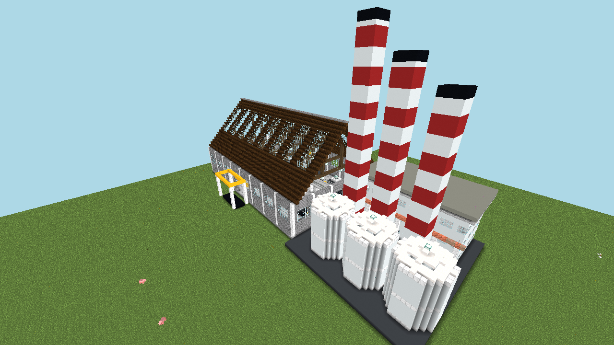
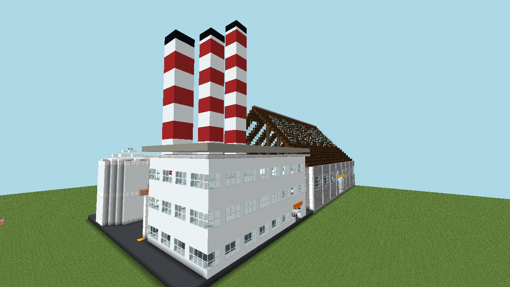
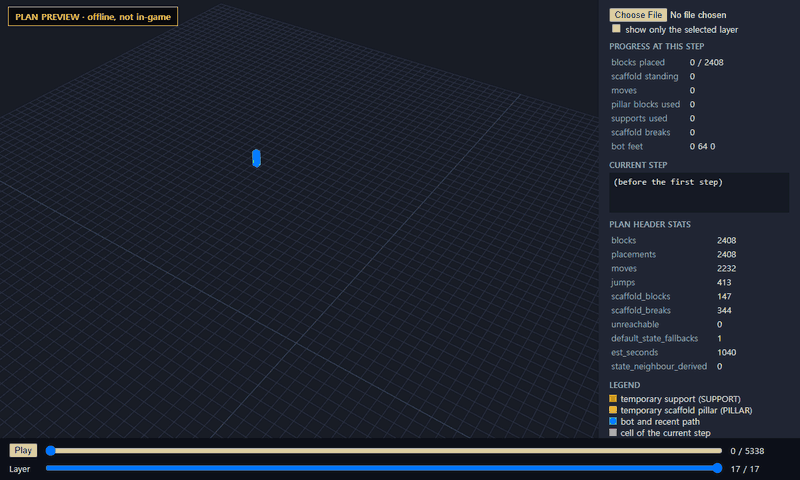
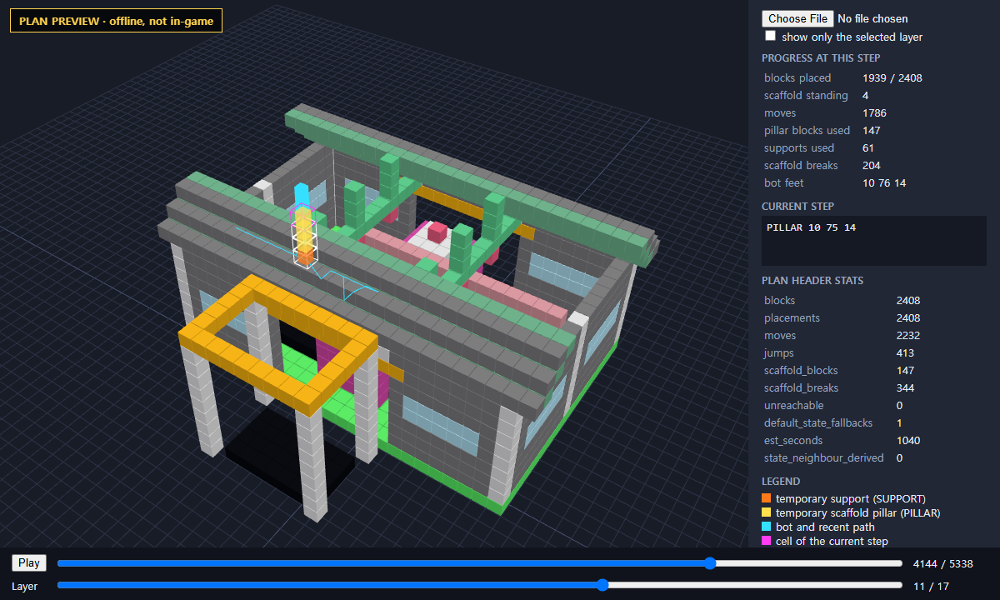
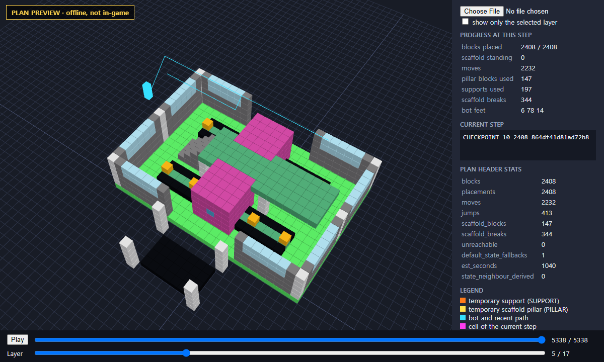
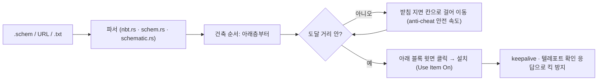

<h1 align="center">schematic-buildbot</h1>

<p align="center"><a href="README.md">English</a> · <b>한국어</b></p>

<p align="center">
  <b>명령 하나로, 설계도(<code>.schem</code> / <code>.litematic</code>)를 URL에서 받아 내 오프라인 크리에이티브 서버에 지어주는 Rust 봇</b><br>
  프로토콜(1.20.4, 1.21.1, 1.21.4, 26.3)을 라이브러리 없이 손으로 구현 · 공중부양/과속 없이 걸어 다니며 건축 · 킥 없음
</p>

<p align="center">
  <a href="https://github.com/lilicoderr/schematic-buildbot/actions/workflows/ci.yml"></a>
  
  
  
  <a href="LICENSE"></a>
</p>

<p align="center">
  
  
</p>
<p align="center"><sub>`tools/preview.py` 로 렌더한 설계도 미리보기 (서버 없이 생성)</sub></p>

## 빠른 시작: 명령 하나

> **지원하는 서버:** **오프라인 모드**(`online-mode=false`) 서버에서 봇이 **크리에이티브 모드**일 때만 됩니다.
> 온라인 모드(정품 인증) 서버는 지원하지 않습니다. 직접 운영하는 서버나 관리자의 허락을 받은 서버에서만 사용하세요.

1. **봇 받기.** [Releases](https://github.com/lilicoderr/schematic-buildbot/releases)에서 Windows 또는 Linux 압축
   파일을 받아 풉니다 (또는 `cargo build --release`).
2. **서버 준비.** `server.properties`에서 `online-mode=false`, `gamemode=creative`로 바꾸고 재시작합니다. 온라인 모드를
   끄면 누구나 아무 이름으로 접속할 수 있으니 비공개나 화이트리스트로 운영하세요. 봇은 평평하고 비어 있는 땅에 짓습니다.
3. **건축.** Windows에서는 `build.bat`을 더블클릭하고 질문(설계도 링크나 파일, 서버 주소, 봇 이름)에 답하면 됩니다.
   또는:

```bash
build-bot build https://example.com/castle.schem 127.0.0.1:25565 --lang ko
```

공유 사이트의 링크는 건축물을 보여 주는 웹 페이지가 아니라 `.schem` / `.litematic` **직접 다운로드 링크**여야 합니다
(아니면 파일을 내려받아 경로를 입력하세요). 이 명령 하나가:

1. 파일을 내려받고 (http/https만, 최대 32 MB, 60초),
2. 상태 요청으로 서버 버전을 감지하고,
3. 모든 단계를 서버 없이 계획한 뒤 **시뮬레이션**합니다. 정확히 재현할 수 없는 블록이 있으면 이유를 알려 주고
   아무것도 짓지 않습니다.
4. 서버를 점검합니다: 접속 불가, 온라인 모드, 지원하지 않는 버전, 크리에이티브가 아님(명령어를 알려 주고 120초 대기),
   접속 거부나 킥(사유 표시). 각각 해결 방법을 안내합니다.
5. 건축하면서 서버가 보고한 블록 상태를 검사하고 틀린 블록을 고칩니다.

**중단됐다면?** 같은 폴더에서 같은 명령을 다시 실행하세요. 계획과 진행 상황이 `.buildbot/`에 남아 있어 같은 자리에서
이어서 짓습니다.

| `build` 옵션 | 뜻 |
|---|---|
| `--dry-run` | 블록 수·예상 시간·지원하지 않는 블록을 출력하고 **접속 없이** 종료 (주소 생략 가능, 1.21.1이 아니면 `--version`) |
| `--origin x,y,z` | 설계도 (0,0,0) 모서리의 월드 좌표. `y`는 봇이 서 있는 높이여야 하고, 접속 위치에서 128칸 이내이며 가는 길이 평평하고 비어 있어야 합니다. 생략하면 접속한 자리 바로 옆 |
| `--name 이름` | 봇 이름 (기본 `BuildBot`) |
| `--lang en\|ko` | 출력 언어 |
| `--allow-partial` | 지원하지 않거나 닿을 수 없거나 상태가 달라지는 블록이 있어도 건축 |
| `--fresh` | 저장된 진행 상황(또는 "완료" 표시)을 지우고 처음부터 |
| `--version V`, `--wait-creative 초`, `--delay-ms N`, `--walk`, `--state-dir 폴더` | 버전 직접 지정, 크리에이티브 대기 시간, 설치 지연, 달리지 않기, 작업 파일 위치 |

2026-11-28 실서버 확인(로컬 바닐라 1.21.1, 소형 공장): 로컬 테스트 웹 서버의 `http://` URL로 `build`를 실행했고,
서바이벌 모드를 감지해 안내한 명령으로 전환했으며, 약 40%에서 봇 프로세스를 강제 종료한 뒤 같은 명령을 다시
실행했습니다. RCON으로 2408/2408 상태 일치, 주변 83,496칸 모두 공기, 킥 0. `--origin`은 `stair-tower.txt`로
확인했습니다(약 20칸 이동, 봇 자체 확인 51/51). 온라인 모드·지원하지 않는 버전·접속 불가·로그인 거부 안내는 모의
서버로만 테스트했습니다.

## 웹 화면: `build-bot ui`

```bash
build-bot ui          # 링크(일회용 키 포함)를 출력하고 Windows에서는 브라우저를 엽니다. Ctrl+C 로 닫습니다
```

<p align="center"></p>

`.schem` / `.litematic` / `.txt` 파일을 화면에 끌어다 놓거나 직접 링크를 붙여넣으세요. `build` 와 똑같이 읽고,
계획하고, **시뮬레이션**합니다. 층 슬라이더가 있는 3D 미리보기(계획 미리보기 도구, three.js 0.160.0 이 라이선스와 함께
프로그램에 들어 있어 오프라인에서도 동작), 크기, 블록 종류, 예상 시간, 건축을 막을 문제가 보입니다. 서버 주소와 봇
이름을 넣고 **건축 시작**을 누르면 진행률, 초당 블록, 남은 시간, 수리 횟수, 로그가 실시간으로 갱신됩니다. **중지**는 두
단계 사이에서 진행을 저장하고 멈추며, 같은 파일과 서버로 **건축 시작**을 다시 누르면 이어서 짓습니다. 여기서 시작한
건축은 명령줄의 `build-bot build` 와 같은 프로세스라서 어느 쪽에서든 이어 짓기가 됩니다. 옵션: `--port N`,
`--no-open`, `--state-dir D`, `--lang en|ko`.

안전: 화면은 **127.0.0.1 에서만** 열립니다(다른 주소를 고르는 옵션이 없습니다). 모든 요청에 실행마다 새로 만든 무작위
키가 필요하고(키는 링크의 `#` 뒤에 있어 브라우저가 어디에도 보내지 않습니다), `Host` 와 `Origin` 이 이 서버 자신의
것이어야 하며(DNS 리바인딩이나 브라우저의 다른 웹사이트는 쓸 수 없음), 업로드는 32 MB, 링크는 http(s) 와 기존 32 MB / 60초
제한, 업로드 이름으로 폴더를 지정할 수 없고, 건축은 셸 없이 인자 목록으로 시작하며 서버 주소와 이름을 먼저 검사하고,
화면은 외부에서 아무것도 불러오지 못합니다(콘텐츠 보안 정책). `crates/mc-bot/tests/webui_security.rs` 가 이것들을 하나씩
공격해 확인합니다.

2026-11-28 헤드리스 Chromium 으로 확인(위아래 스크린샷은 실제 화면이며 게임 화면이 아닙니다): `factory-small.schem` 을
화면에 불러와 로컬 바닐라 1.21.1 서버(127.0.0.1:25569)에 건축, **약 10% 에서 중지 버튼으로 멈췄다가 건축 시작으로 이어
짓기**: RCON(`tools/verify_rcon.py`)으로 2408/2408 상태 일치, 킥 0. 화면은 프로그램 자신 외에는 어떤 요청도 보내지
않았습니다. 확인하지 않은 것: 다른 브라우저, 휴대폰, 루프백이 아닌 네트워크.

<p align="center"> </p>

## 여러 봇이 함께 짓기: `--bots N`

`build-bot build castle.schem host:port --bots 4` (N = 2~4)는 봇 N대가 동시에 건축합니다. 이름은 `BuildBot1` ...
`BuildBot4` (`--name` 뒤에 숫자). 규칙은 그대로입니다. 모든 봇은 땅에서 걷고 점프하며 날지 않고, 블록 상태도 정확합니다.

* **구역.** 설계도를 x 또는 z 방향으로 봇 수만큼 잘라, 각 봇은 자기 구역의 기둥(x,z 칸)에서만 서고, 놓고, 비계를
  세웁니다. 그래서 봇끼리 속도가 달라도 서로의 칸에 블록을 놓거나 서 있을 수 없고, 다른 봇이 필요한 비계를 지우지도
  않습니다. 비계는 각 봇이 소유하고 자기 구역에서 전부 철거합니다. 침대, 이중 상자, 문과 이웃, 매달린 블록과 그
  받침은 절대 가르지 않습니다. 자르는 위치는 봇들의 예상 완료 시간이 고르도록 옮겨 가며 정합니다(후보마다 다시
  계획하므로 계획에 시간이 걸립니다. 작은 공장은 수십 초).
* **뒷 단계.** 한 구역만으로 지을 수 없는 블록(자른 선 건너편 것이 필요한 블록)은 구역에서 빼 두었다가 나중에 1번
  봇이 혼자 짓습니다. 다른 봇은 그때 접속을 끊습니다. 단계 사이에는 동기화 장벽이 있습니다.
* **공동 시뮬레이터** (`mc_bot::multi::joint`). 모든 봇의 계획을 한 월드에서 봇당 플레이어 하나로 6가지 순서(예상
  시간순, 한 봇씩 앞뒤 순서, 무작위 3가지)로 재생합니다. 모든 단계가 엄격한 단일 봇 규칙을 지켜야 하고, 다른 봇의
  몸 안에 블록을 놓거나 들어가면 안 되며, 비계는 주인만 부술 수 있고 다른 봇의 발밑은 안 되며, 결과가 설계도와
  정확히 같아야 합니다. 통과하지 못한 계획은 짓지 않습니다.
* **실행기.** 봇마다 접속과 스레드 하나. 모두 접속해 시작 칸까지 걷고 함께 시작합니다. 부분마다 진행 파일이
  `.buildbot/<작업>/botsN/` 에 있어, 같은 명령을 다시 실행하면 각 봇이 자기 단계부터 이어서 합니다. 한 봇이 실패하거나
  쫓겨나면 나머지는 다음 패킷에서 멈춥니다.
* 각 봇의 검증은 다른 구역의 기둥을 보지 않으므로, 이웃이 놓는 블록을 "고치려" 들지 않습니다.

아직 아닌 것: 단일 봇 `build`의 부지 조사(`--force`)는 다중 봇에 적용되지 않고, 다중 봇 건축의 `undo`와 `ui` 연동은 없습니다.

## 슬라이스 · 시뮬레이션 · 실행 (계획 파이프라인)

3D 프린터 슬라이서처럼, 설계도를 서버 없이 결정적인 계획 파일로 컴파일한 뒤 그대로 재생할 수 있습니다.

```text
 설계도 ──slice──▶ plan.bbplan ──simulate──▶ 합법? ──run──▶ 서버
 (.schem/.litematic) (텍스트 단계:       (메모리 월드에서       (재생, 블록 업데이트로
                      MOVE PILLAR         모든 단계 검사,        정확한 상태 확인,
                      SUPPORT PLACE       최종 월드 == 설계도)   즉시 수리)
                      BREAK CHECKPOINT)
```

```bash
build-bot slice castle.schem -o castle.bbplan          # 서버 없이 오프라인, 시뮬레이션 실패 계획은 거부
build-bot simulate castle.bbplan castle.schem          # 모든 단계 재검사
build-bot run castle.bbplan 127.0.0.1:25566 --verify   # 서버에서 재생
```

실행 중에는 각 단계가 건드린 위치와, 서버가 알려 주는 그 밖의 모든 블록 변화(이웃 갱신, 합쳐진 반블록, 엉뚱한
블록)를 서버가 클릭을 확인(ack)하는 즉시 그 시점에 있어야 할 정확한 상태와 비교합니다. 틀리거나 빠졌거나 불필요한
블록은 부수고 계획 순서대로 다시 놓습니다(위치당 최대 3번). `CHECKPOINT`마다 알려진 모든 위치를 다시 검사합니다.
다시 놓아도 바뀌지 않는 연결 상태와 계단 모양은 보고만 합니다.

계획 포맷은 [docs/PLAN_FORMAT.md](docs/PLAN_FORMAT.md) 참고. 봇은 항상 땅 위에 있습니다. 높은 곳은 한 칸 점프, 임시 비계 기둥
(점프하며 발밑에 설치) 또는 비계 다리로 닿고, 모든 비계는 계획이 끝나기 전에 다시 부숩니다.

로컬 바닐라 1.21.1 서버에서 측정(소형 공장 2408블록): 슬라이스 0.1초, 도달 불가 0개, 실행 235초(10.3블록/초),
RCON으로 2408/2408 상태 일치 확인, 재설치 0, 킥 0. 22k 블록 공장 결과는 다음 절에 있습니다.
이웃에 따라 정해지는 블록 상태(계단 모양, 울타리·유리판 연결)는 클라이언트가 고를 수 없어
슬라이서가 개수를 보고합니다.

## 대형 공장 실서버 건축 (22,481블록)

|  |  |
|---|---|
|  |  |

<p align="center"><sub>건축이 끝난 <b>실서버 월드를 prismarine-viewer로 렌더한 이미지</b>이며, 마인크래프트 클라이언트 스크린샷이 아닙니다 (<code>tools/viewer/capture.js</code>)</sub></p>

`blueprints/factory-large.schem`(22,481블록, 플랜 54,780단계)을 로컬 바닐라 1.21.1 서버(크리에이티브, 오프라인,
힙 2GB, 게임 규칙 기본값, 2026-11-28)의 빈 월드에서 `build-bot run --verify`로 **이어서 실행 없이 한 번에** 지었습니다.
건축 중에는 뷰어나 다른 플레이어가 접속하지 않았습니다. (위 렌더 이미지는 같은 설계도를 이전에 지었을 때의 것입니다.)

* 22,481 / 22,481 설치, 2,822초(47분), **8.0블록/초**, 킥 0회, 거부 0, 누락 0, 서버 로그에 랙이나 이동 경고
  없음. 그중 이동이 2,186초입니다(11,581회 이동, 슬라이서 추정은 이동 2,244초, 전체 2,875초). 달리기와 점프 속도는
  이전과 같은 바닐라 속도이고, 빨라진 것은 건축 순서 덕분입니다. 100블록 단위 속도의 중앙값은 앞 3분의 1이 22블록/초,
  중간이 11, 마지막이 16블록/초입니다.
* 실행 중 모든 단계와 서버가 알려 주는 모든 블록 변화를 계획의 정확한 상태와 비교해 즉시 고칩니다.
  이번 실행은 **수리가 한 번도 필요 없었고**, 최종 보고의 상태 차이는 0개입니다.
* RCON 독립 검증(`tools/verify_rcon.py`), 건축 직후: **22,481개 중 22,481개 상태 일치**.
* 남은 임시 블록: 설계에 없는 건물 주변 721,018칸(사방 16칸, 위로 8칸, 지면부터)을 모두 조회했고 전부 공기였습니다.
* 구리: 검증 시점에 `copper_block` 37개는 모두 산화 전이었습니다. `randomTickSpeed`는 기본값 3 그대로였으므로 이는
  그 시점의 결과입니다. 바닐라에서 밀랍칠하지 않은 구리는 계속 산화합니다. 이전 실행들에서는 건축 중 산화한 구리를
  같은 검사가 찾아 다시 놓았지만, 봇이 떠난 뒤의 산화는 막을 수 없습니다.
* 설계도 하나, 서버 버전 하나, 평지 월드에서의 실행 한 번이며, 다른 건축까지 보장하지는 않습니다.
* 이 설계도의 이전 기록: 층 단위 순서 6,898초(22,479개 일치), 이후 16x16 타일마다 4개 층을 끝내는 순서
  층을 하나씩 끝내는 방식으로 4,685초(22,475개 일치, 미리 알린 통나무 축 폴백 6개), 임시 블록으로 폴백을 없앤 뒤
  4,646초(4.8블록/초, 22,481개 일치). 현재 순서는 8x8 타일의 4개 층 묶음 안에서는 층 순서를 따지지 않아, 벽을 층마다
  돌지 않고 한 자리에서 쌓습니다.

같은 날의 더 이전 건축(역시 이전 순서)은 두 번 이어서 실행해야 했습니다(실행 시간 7,338초, 3.1블록/초). 이때 플래너 버그(같은 반블록
위에 클릭)와 수리 후 걷기만 되던 복귀 경로를 찾아 고쳤습니다. 당시 체크포인트는 공기가 아닌지만 확인해, 위치가
뒤바뀐 반블록/랜턴 3쌍을 끝에서야 발견했습니다. 체크포인트 11에서 블록 4개를 다시 놓은 **원인은 아직 모릅니다**.
새 빌드로 같은 플랜을 거기까지 재생했을 때는 2750/2750에 수리 0회였습니다.

## 슬라이싱 미리보기

3D 프린터 슬라이서의 층별 미리보기처럼, 서버에 접속하기 전에 `.bbplan` 을 눈으로 확인할 수 있습니다.

```bash
cargo run --release --bin build-bot -- slice blueprints/factory-small.schem -o small.bbplan
python tools/plan_preview/build.py small.bbplan -o preview.html   # preview.html 을 브라우저로 열기
```

<p align="center"></p>
<p align="center"><sub><b>계획 미리보기이며 게임 화면이 아닙니다:</b> 소형 공장 계획(5639단계)을 브라우저에서 오프라인 재생</sub></p>

| 임시 블록과 봇 경로 | 층 슬라이더 (0~5층) |
|---|---|
|  |  |

단계·층 슬라이더, 재생 버튼, "선택한 층만 보기", 현재 단계 텍스트와 대상 칸 테두리, 봇과 최근 60개 위치, 벽 너머로도 보이는
임시 받침(주황)과 비계 기둥(노랑), 현재 진행·계획 헤더 통계를 보여줍니다(화면 글자는 영어). HTML 파일 하나이며 three.js 0.160.0 은
jsDelivr 에서 불러오므로 브라우저에 네트워크가 필요합니다. 계획 없이 빌드하면 파일 선택 창으로 엽니다. 블록은 단색 정육면체로만
그립니다(계단·반블록 모양은 표현하지 않음). 계획 내용을 보여줄 뿐이며, 합법성 검사는 뷰어가 아니라 `build-bot simulate` 가 합니다.

이미지를 다시 만들려면:

```bash
cd tools/plan_preview && npm install                     # playwright-core, 해당 Chromium 설치 필요
node render.js ../../preview.html shots frames           # PNG 2장 + GIF 프레임
python gif.py frames shots/plan-preview.gif              # Pillow 필요
```

## 규칙을 어떻게 알아냈나

도달 거리, 설치, 이동, 패킷 규칙은 공식 Minecraft 1.21.1 서버를 공식 Mojang 매핑으로 디컴파일해 읽고(표는 서버의 데이터
생성기 출력) 우리 말로 [docs/RE](docs/RE)에 정리했습니다. Mojang 코드와 jar는 배포하지 않으며, `tools/re` 에는 로컬에서
내려받아 매핑하는 스크립트만 있습니다. 예: 클릭한 블록 상자까지 눈 거리가 생존 5.5 / 크리에이티브 6.0 이내면 수락, 클릭 전에
회전 패킷 전송, 청크 배치 응답, 텔레포트는 정확히 한 번만 확인.

## 기능

| 기능 | 상태 |
|---|---|
| 프로토콜 직접 구현 (핸드셰이크·로그인·Configuration·Play, zlib 압축, 오프라인 UUID) | ✅ |
| `.schem` (Sponge v2/v3) 설계도 + 텍스트 레이어 포맷 | ✅ |
| URL 로 바로 받아 건축 (`http(s)://…/x.schem`) | ✅ |
| 블록 1333종 지원 (블록→아이템 ID 테이블) | ✅ |
| `--dry-run` 검증 + 층별 ASCII 도면 + 공중 블록 경고 | ✅ |
| 걸어 다니며 설치 (`on_ground`, 틱당 걷기 속도 이하) — anti-cheat 안전 | ✅ |
| `--delay-ms` 로 설치 속도 제한 (패킷 레이트 제한 서버용) | ✅ |
| `tools/preview.py` — 설계도 → 아이소메트릭 PNG (Python 표준 라이브러리만) | ✅ |
| 블록 상태: 계단 방향/위아래, 반블록(위/아래/통), 통나무 축, 문·침대·화로 방향 | ✅ 클릭 면·커서·시선으로 재현 (`--dry-run` 이 재현 불가 항목 보고) |
| 공중 블록 안전 순서 (이웃/위 블록을 받침으로 사용) | ✅ |
| `--resume` 이어 짓기 · `--rate` 초당 설치 상한 | ✅ |
| `--lang en\|ko` 출력 언어 | ✅ |
| `.litematic` (Litematica, 다중 리전 · 비트 패킹 팔레트) | ✅ |
| 여러 마인크래프트 버전 (`--version`) | ✅ [지원 버전](#지원-버전) 참고. 그 외 버전은 [ViaProxy](https://github.com/ViaVersion/ViaProxy) 경유 |
| 생존 모드 + 상자에서 자재 꺼내기 | 🚧 필요한 패킷 ID 는 매핑됨 |

## 지원 버전

`--version` 으로 고릅니다(기본 1.21.1). 계획 파이프라인에서는 `slice` 에 지정하면 계획 파일에 프로토콜이 기록됩니다.
아래 버전은 모두 자동 생성한 ID 표가 있고, 버전마다 다른 패킷 구조는 바이트 단위의 단위 테스트가 있습니다.
마지막 열은 해당 버전의 로컬 바닐라 서버(크리에이티브, 오프라인)에서 실제로 돌린 결과입니다.

| 버전 | 프로토콜 | 표 + 단위 테스트 | 실서버 |
|---|---|---|---|
| 1.20.4 | 765 | ✅ | ✅ 현재 플래너: 짧은 건축, 2408블록 공장 2408/2408 상태 일치, 235초 |
| 1.21 | 767 | ✅ (1.21.1과 공용) | 따로 실행 안 함 |
| 1.21.1 | 767 | ✅ | ✅ 현재 플래너: 2408블록 공장 2408/2408, 22,481블록 공장 22,481/22,481 상태 일치. 짧은 건축은 이전 플래너로 확인 |
| 1.21.4 | 769 | ✅ | ✅ 현재 플래너: 짧은 건축, 2408블록 공장 2408/2408 상태 일치, 235초 |
| 26.3 | 777 | ✅ | ✅ 현재 플래너: 짧은 건축, 2408블록 공장 2408/2408 상태 일치, 236초 |

2026-11-28에 현재 건축 순서로 1.20.4·1.21.4·26.3을 다시 검증했습니다(코드 `2d5146e`, 계획 파이프라인,
`run --verify`, 매번 비운 땅에 건축한 뒤 RCON으로 블록별 비교): `factory-small.schem` 2408/2408(설계도와 직접 비교),
`cottage.txt` 25/25, `stair-tower.txt` 51/51, `state-lab.txt` 27/27(문 위쪽 절반 포함), `pixel-heart.txt` 27/27, 너비 5·높이 9의
벽 45/45(비계를 쌓고 제거), 나란한 단일 상자 3개 3/3(웅크리기 필요. 벽과 상자 설계도는 저장소에 없음). 모두 상태까지 일치,
재설치 0, 킥 0, 서버 로그에 이동·랙 경고 없음. 각 건물 주변 상자(사방 16칸, 위로 8칸, 지표면부터)에서 설계 밖의 칸은
모두 공기였습니다. 직접 건축 모드의 `stair-tower.txt` 는 서버 블록 업데이트로 51/51 확인(봇 자체 확인이며 RCON 아님).
대형 공장은 이 세 버전에서 **짓지 않았습니다**. 생존·온라인 모드, Paper/Spigot, 표에 없는 버전은
미검증입니다. 버전별 차이는 [docs/RE/versions.md](docs/RE/versions.md) 참고.

## 빌드 · 실행 (하위 모드)

건축에는 위의 [명령 하나](#빠른-시작-명령-하나)를 쓰세요. 아래의 직접 모드는 계획 없이 블록을 놓습니다.

```bash
cargo build --release

./target/release/build-bot 127.0.0.1:25566 BuildBot blueprints/cottage.txt        # 건축
./target/release/build-bot x x blueprints/cottage.txt --dry-run                     # 검증만
./target/release/packet-probe probe 127.0.0.1:25566 ProbeBot 6                     # 패킷 6초 수집·분류
python tools/preview.py blueprints/cottage.txt -o docs/cottage.png --scale 36       # 미리보기 PNG
./target/release/build-bot 127.0.0.1:25566 Bot blueprints/stair-tower.txt --resume   # 중단돼도 이어서
```

대상은 `online-mode=false`(오프라인) 서버. 로컬 테스트는 바닐라 1.21.1 을 `online-mode=false`, `gamemode=creative` 로 띄우면 된다
(봇은 크리에이티브에서 블록을 손에 들어 설치한다).

> 온라인 모드(Mojang 인증/암호화)는 범위 밖이다. 남의 서버에서는 반드시 서버 운영자의 허락을 받고 사용할 것.

## 설계도 포맷

`.schem` 외에, 손으로 그리기 쉬운 레이어/팔레트 텍스트도 지원한다 (`blueprints/` 참고).

```text
name 작은 오두막
palette W white_concrete
palette G glass
layer 0          # y=0 평면. 아래 각 줄이 z 증가, 글자가 x 증가
WWW
W.W              # '.' 또는 공백 = 공기
WWW
layer 1
WGW
```

## 동작 원리



```text
crates/mc-proto/      VarInt/VarLong, 문자열, Position, UUID, 길이 프레이밍 + zlib (의존성: flate2)
crates/mc-bot/
  net.rs  proto.rs    TCP · 핸드셰이크/상태핑/오프라인 로그인/Config
  data/               버전별 패킷·아이템·블록 표 (tools/re/gen_tables.py 로 생성)
  version.rs · codec.rs  버전 선택, 버전마다 다른 패킷 구조
  world.rs            좌표 · 시야(yaw/pitch) · 도달 거리
  nbt.rs schem.rs     NBT 리더 · Sponge .schem 파서
  schematic.rs        설계도 모델 · 건축 순서 · ASCII 도면 · 공중 블록 검출
  builder.rs          Play 클라이언트: 이동 · 설치 · keepalive
  blocks.rs           블록 → 아이템 ID (1333종)
  bin/                build-bot, packet-probe
tools/preview.py      설계도 → 아이소메트릭 PNG
```

## 왜 손으로 구현했나

- 패킷/프로토콜 수준을 직접 이해하고 검증하려고. VarInt(LEB128), Position 패킹(26/12/26), zlib 프레이밍, Configuration 전이, 오프라인 UUID(MD5)를 직접 구현하고 공식 테스트 벡터로 검증했다.
- 패킷 ID 는 [minecraft-data](https://github.com/PrismarineJS/minecraft-data) 1.21.1 정의와 대조했다.

## 이동과 anti-cheat

- 항상 `on_ground=true`, 틱당 이동량을 걷기 속도(~0.26블록) 이하로 제한 → "moved too quickly"/"flying is not enabled" 킥 없음.
- 블록은 "아래 블록의 윗면"을 눌러 설치하므로 받침 없는 공중 설치를 하지 않는다. 받침이 없는 블록은 `--dry-run` 이 미리 경고한다.
- 서버의 Synchronize Player Position(텔레포트)에는 Confirm Teleport 로 즉시 응답한다.

## 검증

- `cargo test --workspace` — 단위 테스트 (VarInt/Position/zlib/MD5 벡터, 설계도·`.schem` 파싱, ASCII 도면, 공중 블록, 도달 거리 …)
- 실서버(로컬 바닐라 1.21.1, 크리에이티브, 오프라인)를 RCON(`execute if block … <상태>`)으로 블록별 확인, 모든 실행에서 킥 없음:
  `cottage.txt` 25/25, `stair-tower.txt` 51/51 (통블록 반블록·계단 방향·통나무 축 일치), `state-lab.txt` 26개 + 문 윗칸 자동 생성 (위쪽 계단·가로 통나무·화로·상자·문 일치), `--resume` 39/51에서 중단 후 이어 짓기 완료.
- 아직 실서버 미검증: Paper/Spigot 등 다른 서버, [지원 버전](#지원-버전) 외 버전, 문 경첩·다락문·버튼 등. 마인크래프트 클라이언트 스크린샷은 찍지 않았습니다(공장 이미지는 prismarine-viewer 렌더). 위 결과는 서버측 블록 조회 기준입니다.

## 기여

[CONTRIBUTING.md](CONTRIBUTING.md) · 변경 내역은 [CHANGELOG.md](CHANGELOG.md).

## 라이선스

MIT. 패킷 ID 는 PrismarineJS/minecraft-data(1.21.1)와 대조했다.
