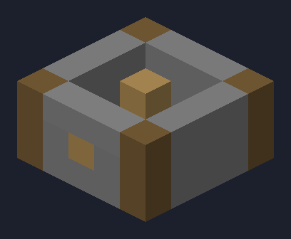
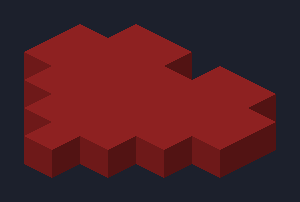
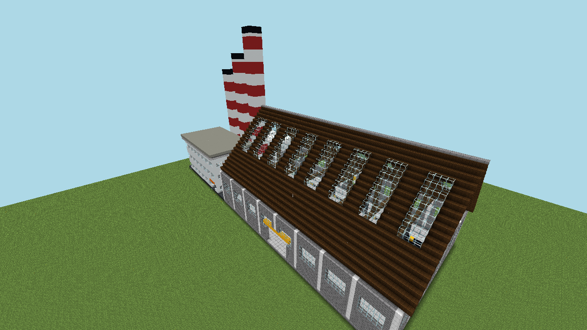
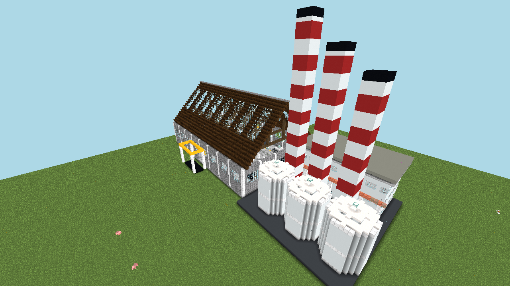
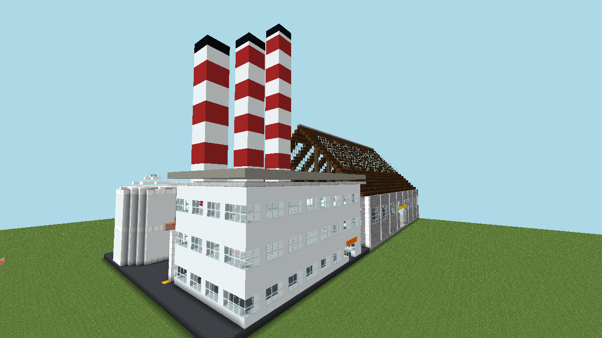
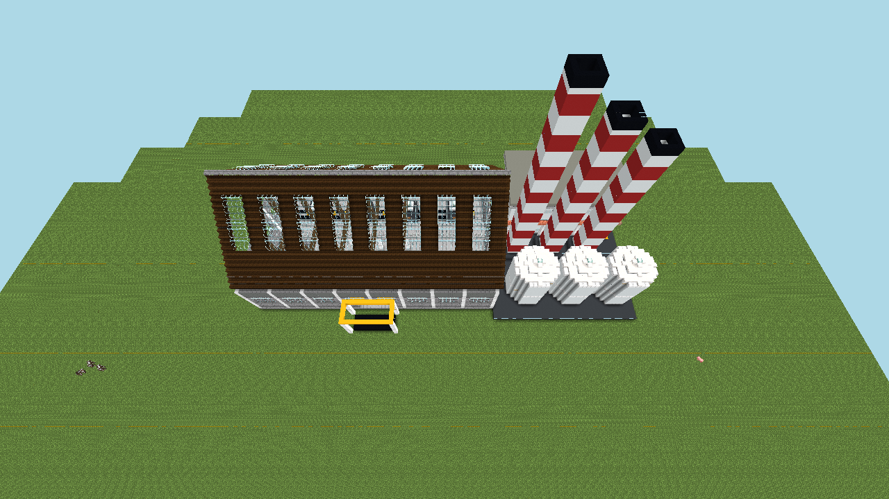
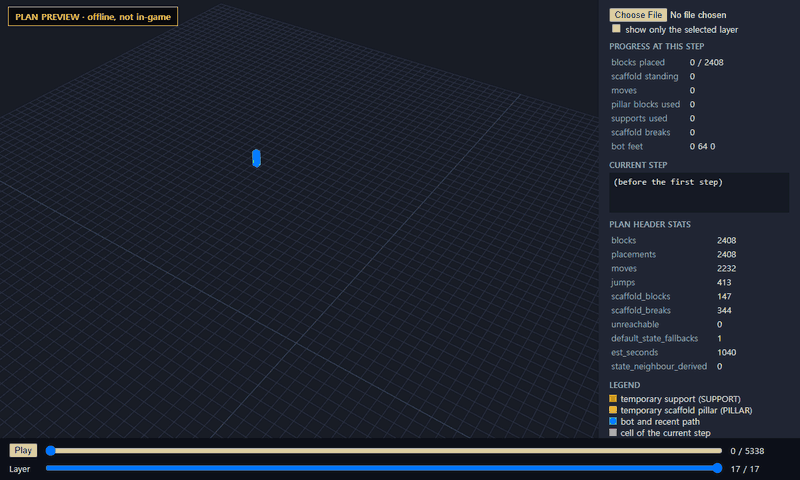
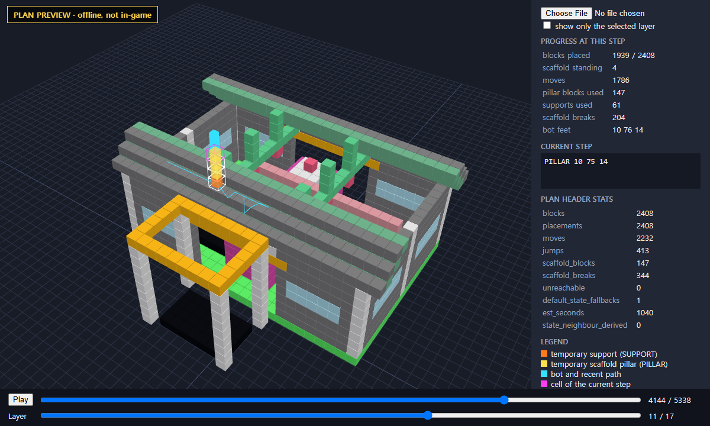
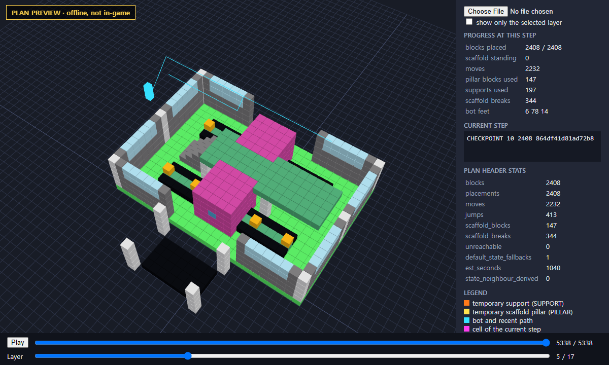
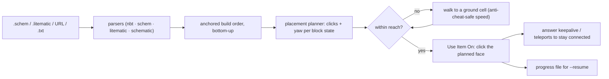

<h1 align="center">schematic-buildbot</h1>

<p align="center"><b>English</b> · <a href="README.ko.md">한국어</a></p>

<p align="center">
  <b>A Rust bot that downloads a Minecraft schematic from a URL and builds it on your server.</b><br>
  Hand-written protocol (1.20.4, 1.21.1, 1.21.4, 26.3), no libraries · walks like a player, never flies or speeds · block states supported
</p>

<p align="center">
  <a href="https://github.com/lilicoderr/schematic-buildbot/actions/workflows/ci.yml"></a>
  
  
  
  <a href="LICENSE"></a>
</p>

<p align="center">
  
  
  
</p>
<p align="center"><sub>Blueprint previews rendered by <code>tools/preview.py</code> (no server needed)</sub></p>

## At a glance

```bash
# Paste a direct .schem / .litematic link from a schematic site: it downloads and builds.
build-bot 127.0.0.1:25565 MyBot https://example.com/castle.schem

# Validate offline: size, block list, layer map, which block states can be reproduced.
build-bot x x castle.schem --dry-run

# Interrupted (kick, crash, Ctrl-C)? Continue exactly where it stopped.
build-bot 127.0.0.1:25565 MyBot castle.schem --resume
```

```text
=== blueprint check: 'Stair tower' ===
size 5x3x5 (x 0..4, y 0..2, z 0..4), 51 blocks
block types:
     33  stone_bricks
     12  oak_log
      4  stone_slab
      2  oak_stairs
All blocks can be placed.
...
block states: 18 blocks carry states; 18 will match exactly, 0 second-half blocks are placed automatically
```

## Slice, simulate, run (plan pipeline)

Like a 3D-printer slicer, the bot can compile a schematic offline into a deterministic plan and replay it:

```text
 schematic ──slice──▶ plan.bbplan ──simulate──▶ legal? ──run──▶ server
 (.schem/.litematic)  (text steps:       (every step checked   (replay, confirm each
                       MOVE PILLAR        in an in-memory       step against the
                       SUPPORT PLACE      world, final world    exact block states,
                       BREAK CHECKPOINT)  == schematic)         repair at once)
```

```bash
build-bot slice castle.schem -o castle.bbplan          # offline, no server; refuses plans that fail simulation
build-bot simulate castle.bbplan castle.schem          # re-check every step
build-bot run castle.bbplan 127.0.0.1:25566 --verify   # replay on a server
```

While running, every position a step touched, and every other block change the server reports (neighbour updates, slabs
that merged, stray blocks), is compared with the state the plan wants there at that moment, as soon as the server has
acknowledged the clicks. Wrong, missing or stray blocks are broken and placed again in plan order (at most 3 times per
position); every `CHECKPOINT` audits all known positions again. Connections and stair shapes that placing again cannot
change are only reported.

The plan format is in [docs/PLAN_FORMAT.md](docs/PLAN_FORMAT.md). The bot stays on the ground: high spots are reached by
jumping up one block, by temporary scaffold pillars (jump, place under the feet, land) or scaffold bridges, and every scaffold
block is broken again before the plan ends.

Measured on a local vanilla 1.21.1 server (small factory, 2408 blocks): sliced in 0.1 s with 0 unreachable blocks,
run in 235 s (10.3 blocks/s), 2408/2408 states exact over RCON, 0 re-placed, 0 kicks. For the 22k-block factory see the next section.
Neighbour-derived block states (stair shape, fence and pane connections) cannot be chosen by a client; the slicer counts them.

## Large factory: live build (22,481 blocks)

|  |  |
|---|---|
|  |  |

<p align="center"><sub><b>prismarine-viewer renders of the live world</b> after the build, not Minecraft client screenshots (<code>tools/viewer/capture.js</code>)</sub></p>

`blueprints/factory-large.schem` (22,481 blocks, 54,780 plan steps), built by `build-bot run --verify` on a local vanilla
1.21.1 server (creative, offline, 2 GB heap, default gamerules, 2026-11-28), from an empty world, **in one run with no
resume**, with no viewer or other player connected. (The renders above are of an earlier build of the same schematic.)

* 22,481 / 22,481 placed, 2,822 s (47 min), **8.0 blocks/s**, 0 kicks, 0 refused, nothing missing, no lag or
  movement warning in the server log. Walking took 2,186 s of it (11,581 moves; the slicer estimated 2,244 s walking,
  2,875 s total), at the same vanilla sprint and jump speed as before: the gain comes from the build order. Median
  speed per 100 placements: 22 blocks/s in the first third, 11 in the middle, 16 in the last.
* The run checks every step and every block change the server reports against the exact planned state, and repairs
  at once. This run needed **no repair**, and its final report lists 0 differing states.
* Independent check over RCON (`tools/verify_rcon.py`), right after the build: **22,481 / 22,481 states exact**.
* Leftover scaffold: 721,018 cells around the build that are not in the schematic (16 blocks to each side and 8 above,
  from the ground up) were queried; all are air.
* Copper: all 37 `copper_block`s were unaged at the time of the check. `randomTickSpeed` was left at the default 3, so
  this is a point-in-time result: vanilla keeps ageing unwaxed copper. In earlier runs, copper that aged during the
  build was seen and placed again by the same checks; nothing keeps it unaged after the bot has left.
* This is one run on one schematic, one server version and a flat world; it is not a guarantee for other builds.
* History with this schematic: 6,898 s with the older layer-by-layer order (22,479 exact), then 4,685 s with the
  4-layers-per-16x16-tile order, one layer after another (22,475 exact, 6 declared log-axis fallbacks), and 4,646 s
  (4.8 blocks/s, 22,481 exact) once temporary blocks had removed those fallbacks. The current order finishes a band
  of 4 layers in an 8x8 tile in any layer order, so a wall is built from one spot instead of once per layer.

An earlier build the same day, also with the older order, needed two resumes (7,338 s active, 3.1 blocks/s). It exposed a planner bug (a slab clicked
onto an equal slab) and a walk-only way back after repairs; both are fixed. Its checkpoints only counted non-air blocks, so
three swapped slab / lantern pairs were only found at the end. At its checkpoint 11 four blocks were placed again for a
**cause that is still unknown**: replaying that plan up to there with the new build gave 2750/2750 and no repair.

## Slicing preview

Like the layer preview of a 3D-printer slicer, a `.bbplan` can be inspected before any server is involved:

```bash
cargo run --release --bin build-bot -- slice blueprints/factory-small.schem -o small.bbplan
python tools/plan_preview/build.py small.bbplan -o preview.html   # open preview.html in a browser
```

<p align="center"></p>
<p align="center"><sub><b>Plan preview, not in-game:</b> the small factory plan (5639 steps) replayed offline in the browser</sub></p>

| Temporary blocks and bot path | Layer slider (layers 0 to 5) |
|---|---|
|  |  |

Step and layer sliders, play button, "only this layer" switch, the current step as text with its cell outlined, the bot and
its last 60 positions, temporary supports (orange) and scaffold pillars (yellow) visible through walls, and live and header
statistics. The page is a single HTML file; three.js 0.160.0 is loaded from jsDelivr, so the browser needs network access.
Built without a plan argument, it has a file picker instead. Blocks are drawn as flat-coloured cubes (stairs, slabs and
other shapes are not modelled). It shows what the plan says; legality is checked by `build-bot simulate`, not by the viewer.

To regenerate the images:

```bash
cd tools/plan_preview && npm install                     # playwright-core; needs its Chromium installed
node render.js ../../preview.html shots frames           # two PNGs + GIF frames
python gif.py frames shots/plan-preview.gif              # needs Pillow
```

## How the rules were derived

The reach, placement, movement and packet rules are read from the official Minecraft 1.21.1 server (decompiled with the
official Mojang mappings, tables from the server's own data generator) and written down in our own words in
[docs/RE](docs/RE). No Mojang code or jars are distributed; `tools/re` holds the scripts that fetch and map them locally.
Examples: a click is accepted when the eye is within 5.5 (survival) / 6.0 (creative) blocks of the clicked block's box, the
bot must send a rotation packet before clicking, answer chunk batches and confirm each teleport exactly once.

## Features

| Feature | Status |
|---|---|
| Hand-written protocol: handshake, login, Configuration, Play, zlib, offline UUIDs | ✅ |
| `.schem` (Sponge v2/v3), `.litematic` (multi-region) and a plain-text layer format | ✅ |
| Build straight from a URL (`http(s)://…/x.schem`) | ✅ |
| 1333 block types (block → item id table) | ✅ |
| **Block states**: stairs facing/half, slabs bottom/top/double, log axis, door/bed/furnace/chest facing | ✅ see [How states work](#block-states) |
| Anchored build order: overhangs are built from neighbours, floating islands are reported | ✅ |
| `--dry-run`: layer map, unregistered blocks, state report, floating-block warning | ✅ |
| Walks on the ground (`on_ground`, below walking speed): no fly/speed kicks | ✅ |
| `--rate` / `--delay-ms`: cap the placement rate for strict servers | ✅ |
| `--resume`: continue an interrupted build from a progress file | ✅ |
| `--lang en\|ko`, `BUILDBOT_LANG`: English and Korean output | ✅ |
| `tools/preview.py`: blueprint → isometric PNG (Python standard library only) | ✅ |
| Several Minecraft versions (`--version`) | ✅ see [Supported versions](#supported-versions); other releases via [ViaProxy](https://github.com/ViaVersion/ViaProxy) |
| Survival mode, taking materials from chests | 🚧 needed packet ids are mapped |

## Supported versions

Pick one with `--version` (default 1.21.1). With the plan pipeline, give it to `slice`; the plan records the protocol.
All of them have generated id tables, and the packet layouts that differ have byte-level unit tests. The last column is
what ran on a local vanilla server of that release (creative, offline).

| Version | Protocol | Tables + unit tests | Live |
|---|---|---|---|
| 1.20.4 | 765 | ✅ | ✅ planner of `48ee50e`: short builds; 2408-block factory 2408/2408 exact, 466 s |
| 1.21 | 767 | ✅ (shares 1.21.1's) | not run separately |
| 1.21.1 | 767 | ✅ | ✅ current planner: 22,481-block factory 22,481/22,481 exact, 2408-block factory 2408/2408 exact; short builds with an older planner |
| 1.21.4 | 769 | ✅ | ✅ planner of `48ee50e`: short builds; 2408-block factory 2408/2408 exact, 464 s |
| 26.3 | 777 | ✅ | ✅ planner of `48ee50e`: short builds; 2408-block factory 2408/2408 exact, 466 s |

The later build-order change (see the large factory above) was run live on 1.21.1 only. Re-verified on 2026-11-28 with the planner of `48ee50e` on 1.20.4, 1.21.4 and 26.3 (code `7d7ce4c`, through the plan
pipeline, `run --verify`, each build on a cleared area, then compared block by block over RCON): `factory-small.schem`
2408/2408 (against the schematic), `cottage.txt` 25/25, `stair-tower.txt` 51/51, `state-lab.txt` 27/27 (including the
door's upper half), `pixel-heart.txt` 27/27, a 5-wide 9-high wall 45/45 (builds and removes scaffold) and three single
chests in a row 3/3 (needs sneaking; the wall and chest blueprints are not in the repo). All exact; 0 re-placed,
0 kicks, no movement or lag warning in the server logs. In a box around each build (16 blocks to each side, 8 above,
from the ground surface up) every cell outside the build was air. `stair-tower.txt` in direct mode: 51/51 confirmed by
the server's block updates (the bot's own check, not RCON). The large factory has **not** been built on these three
releases.
Survival mode, online mode, Paper/Spigot and releases not listed are untested. Differences between releases:
[docs/RE/versions.md](docs/RE/versions.md).

## Install & run

```bash
cargo build --release

./target/release/build-bot 127.0.0.1:25566 BuildBot blueprints/cottage.txt         # build
./target/release/build-bot x x blueprints/stair-tower.txt --dry-run                # validate only
./target/release/packet-probe probe 127.0.0.1:25566 ProbeBot 6                     # sample and classify packets for 6 s
python tools/preview.py blueprints/cottage.txt -o docs/cottage.png --scale 36      # preview PNG
```

Targets `online-mode=false` (offline) servers. For local testing run vanilla 1.21.1 with
`online-mode=false` and `gamemode=creative` (the bot puts blocks in hand via creative slots).

> Online mode (Mojang auth/encryption) is out of scope. Only use this on servers whose operator allows it.

### Options

| Option | Meaning |
|---|---|
| `--dry-run` | validate and print a report, then exit (no server needed) |
| `--delay-ms N` / `--rate N` | pause after each placement / cap placements per second |
| `--version V` | Minecraft version of the server (default `1.21.1`, see [Supported versions](#supported-versions)) |
| `--resume`, `--progress-file F` | continue from `.buildbot-progress` (or `F`) |
| `--lang en\|ko` | output language (also `BUILDBOT_LANG`; defaults to your locale) |

## Block states

In vanilla the placed state is decided by the **click**, not the item: clicked face, cursor
position inside that face, and the player's horizontal facing. `placement.rs` turns a wanted
state into those inputs:

| Block family | State | How the bot gets it |
|---|---|---|
| stairs, doors, fence gates, beds | `facing` | looks along `facing` while clicking |
| furnaces, chests, carved pumpkins, glazed terracotta, … | `facing` | looks the opposite way |
| stairs | `half=top` | clicks the underside of the block above, or the upper half of a neighbour's side |
| slabs | `type=top/double` | same as stairs; `double` clicks twice |
| logs, pillars, hay/bone blocks | `axis=x/y/z` | clicks a face along the axis on a neighbouring block; the planner (`slice`) puts a temporary block there if there is none and removes it again |

With `slice`, every blueprint in this repository now has 0 such fallbacks (checked by `tests/exact_axes.rs`). Otherwise,
anything the surroundings do not allow (no neighbour to click) falls back to the default state and is
listed in the run summary and in `--dry-run`. Upper door halves and bed heads are skipped because the
server creates them with the first half. Trapdoors, buttons, levers and 6-way blocks currently use
the default state.

## Blueprint format

Besides `.schem` / `.litematic`, a hand-drawable layer/palette text format is supported (see `blueprints/`):

```text
name Small cottage
palette W white_concrete
palette T oak_stairs[facing=east,half=bottom]   # states go in brackets
layer 0          # the y=0 plane; each row below is one z, each character one x
WWW
W.W              # '.' or a space is air
WWW
```

## How it works



```text
crates/mc-proto/      VarInt/VarLong, strings, Position, UUID, length framing + zlib (dep: flate2)
crates/mc-bot/
  net.rs  proto.rs    TCP · handshake / status ping / offline login / Configuration
  data/               per-version packet, item and block tables (generated by tools/re/gen_tables.py)
  version.rs          version table behind --version and per-version packet layouts
  codec.rs            packet bodies that differ between releases
  world.rs            coordinates · faces · view angles · reach
  nbt.rs schem.rs litematic.rs   NBT reader · Sponge .schem and Litematica parsers
  schematic.rs        blueprint model · block states · anchored build order · ASCII map
  placement.rs        block state → clicks, cursor and yaw (pure, unit-tested)
  builder.rs          Play client: movement · placement · keepalive
  progress.rs         resume file
  i18n.rs             en/ko message switch
  blocks.rs           block → item id of the chosen version
  bin/                build-bot, packet-probe
tools/preview.py      blueprint → isometric PNG
```

## Why hand-written?

- To understand and verify the protocol itself: VarInt (LEB128), Position packing (26/12/26), zlib framing,
  the Configuration transition and offline UUIDs (MD5) are implemented here and checked against official test vectors.
- Packet ids are cross-checked against [minecraft-data](https://github.com/PrismarineJS/minecraft-data) 1.21.1.

## Movement and anti-cheat

- Always `on_ground=true`, and per-tick movement stays below walking speed (~0.26 blocks), so no
  "moved too quickly" / "flying is not enabled" kicks.
- Blocks are placed by clicking a face of something that already exists, never in mid-air. Blocks with
  nothing to rest on are reported by `--dry-run`.
- Synchronize Player Position (teleport) is answered with Confirm Teleport immediately.

## What is verified

- `cargo test --workspace` (50+ unit tests, no server needed): VarInt/Position/zlib/MD5 vectors,
  blueprint and `.schem`/`.litematic` parsing, build ordering, the block-state planner, progress file,
  version table. CI also runs `clippy -D warnings` and a bilingual `--dry-run` smoke test.
- Live server (local vanilla 1.21.1, creative, offline), checked block by block over RCON
  (`execute if block … <state>`), no kick in any run:

  | Blueprint | Result |
  |---|---|
  | `cottage.txt` | 25/25 blocks |
  | `stair-tower.txt` | 51/51: double slab, stairs `facing=north/east`, bottom slabs, vertical logs all matched |
  | `state-lab.txt` | 26 placed + door upper half auto-created: top-half stairs, `axis=x` logs, furnace, chest, door matched |
  | `--resume` | killed at 39/51, resumed: 12 more blocks, structure complete, progress file removed |

- **Not verified live:** other servers/forks (Paper, Spigot, …), releases outside [Supported versions](#supported-versions), door hinges, trapdoors,
  buttons and other families listed as unsupported. No Minecraft client screenshots were taken (the factory images are
  prismarine-viewer renders); the table above is from server-side block queries.

## Contributing

[CONTRIBUTING.md](CONTRIBUTING.md) · changes in [CHANGELOG.md](CHANGELOG.md).
Good first areas: more state families (trapdoors, buttons, 6-way blocks), support for
another version ([how](docs/RE/versions.md)), survival mode with chests.

## License

MIT. Packet ids were cross-checked with PrismarineJS/minecraft-data (1.21.1).
